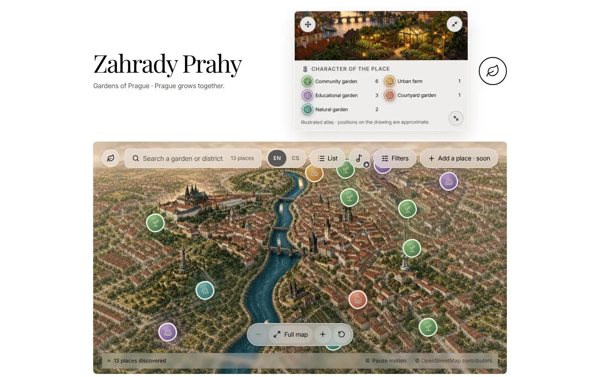
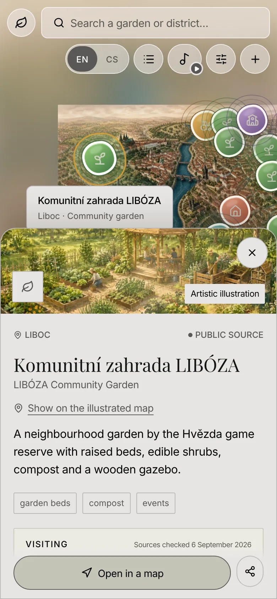

# Zahrady Prahy — Gardens of Prague

**A living, illustrated map of Prague's community gardens.**

[](LICENSE)
[](https://github.com/usnea-communitas/zahrady-prahy/actions/workflows/ci.yml)
[](LICENSE-ASSETS.md)
[](package.json)
[](#localisation)

**Live:** <https://zahrady-prahy.vercel.app>

Zahrady Prahy ("Gardens of Prague") is a storybook-style illustrated map of
Prague with thirteen community gardens drawn on it. Click a garden and you get
its illustration, a short description, practical visiting information where
every fact carries its source and the date it was checked, and a link to the
real location on a geographic map. The interface is in English by default and
fully available in Czech.



<p align="center">
  
</p>

## What it does

- **An illustrated atlas, not a navigation map.** Prague is drawn as a
  hand-painted storybook plate; the thirteen gardens are placed on it
  editorially. Each garden has its own illustration, labelled as an artistic
  rendering. A link in every detail panel opens the real coordinates in a
  geographic map.
- **Search that ignores diacritics**, in both languages: "liboza", "LIBÓZA",
  "wheelchair" and "bezbariérové" all work, and words can come in any order.
- **Category legend and feature filters** (for children, wheelchair accessible,
  compost, events), and a plain list for anyone who prefers it to the map.
- **Shareable links.** `?zahrada=liboza` opens a garden directly (`?garden=`
  is accepted as an alias); search, category and filters round-trip through
  the URL too.
- **Sourced visiting information.** Access, opening hours, where to find the
  entrance and how to take part are separate facts, each with a source link
  and a check date. When a source does not publish a regular schedule, the
  atlas says so instead of guessing: _not found_ means "no regular schedule
  found", never "closed".
- **An optional soundscape**, "Zahrady nad Vltavou", that plays only when you
  press the note button. Nothing autoplays.
- **Keyboard accessible**: the map pans with the arrow keys and zooms with
  `+`/`-`/`0`, panels return focus to where you came from, and status changes
  (sound, full screen, copied link) are announced through `aria-live`
  regions.
- **No tracking, no data collection.** No analytics, no cookies, no forms. The
  only things stored are in your own browser: the chosen language and the
  postcard's position.
- Built for desktop; a phone layout exists (map full screen, details and list
  as bottom sheets) but is secondary.

## Who it is for

People who want to explore Prague's community gardens and urban nature on
their own, at their own pace. It is a project of
[Usnea communitas, z. s.](https://usnea.ngo), a Czech nonprofit association
focused on education, community and permaculture.

## Tech stack

- [React 19](https://react.dev) with the App Router conventions of Next.js,
  run by [vinext](https://github.com/cloudflare/vinext) on
  [Vite](https://vite.dev)
- [TypeScript](https://www.typescriptlang.org), strict
- [Tailwind CSS 4](https://tailwindcss.com) for utilities, plus hand-written
  CSS for the atlas
- [Base UI](https://base-ui.com) primitives through
  [shadcn](https://ui.shadcn.com) (button, input, dialog)
- [lucide-react](https://lucide.dev) icons
- Tests with the built-in `node:test` runner, linting with
  [oxlint](https://oxc.rs), formatting with oxfmt
- Deployed on [Vercel](https://vercel.com) (`npm run build:vercel`)

No database, no backend, no third-party scripts at runtime. Fonts are
downloaded at build time and self-hosted.

## Getting started

Requires Node.js 22.13 or newer.

```sh
npm ci               # install exactly the locked dependencies
npm run dev          # start the development server
npm test             # run the unit tests (node --test)
npm run lint         # oxlint
npm run typecheck    # tsc --noEmit
npm run build:vercel # production build as deployed on Vercel
```

`npm run build` and `npm start` produce and serve the Cloudflare Workers
variant of the build (the project scaffold's original target); the live site
uses the Vercel build.

## Project structure

```
app/
  layout.tsx            Metadata (English by default) and the locale provider
  page.tsx              The whole atlas: map, header, filters, details, dialogs
  globals.css           Base styles and atlas chrome
  atlas.css, gallery.css, mobile.css
                        Structural, theme and phone-layout overrides
components/
  i18n/                 LocaleProvider (locale state, useT hook) and LanguageSwitcher
  map/                  MapViewport (pan/zoom, keyboard) and MapMotionLayer (boats, birds)
  ui/                   shadcn/Base UI primitives
lib/
  i18n.ts               Interface dictionary (en, cs), locale helpers, date formatting
  gardens.ts            The garden catalogue, categories, tags, filters and search
  garden-visits.ts      Visiting facts with sources and check dates, per garden
  atlas-navigation.ts   URL state: ?q, ?zahrada (alias ?garden), ?typ, ?filtry
  webmcp.ts             Optional read-only catalogue search for browsers with WebMCP
  map/                  Viewport maths, projection and river geometry
public/
  map/, gardens/, audio/  Illustrations, sprites and the soundscape (see LICENSE-ASSETS.md)
tests/                  Unit tests: catalogue, i18n, navigation, viewport
docs/                   Rebuild notes and media provenance (prompts and tools)
design/                 Design tokens and theme reference
scripts/                One-off asset build scripts (sprites, map reference)
PRODUCT.md              Product principles the project is held to
```

## Adding or correcting a garden

The catalogue is plain TypeScript, so a correction is a small pull request.

1. **Facts about a garden** (description, tags, category, coordinates, source
   page) live in [`lib/gardens.ts`](lib/gardens.ts). Every reader-facing text
   is written in both languages (`{ cs, en }`). Names, neighbourhoods and street
   addresses are proper nouns and stay in Czech; add an English `gloss` for the
   name where it helps.
2. **Visiting information** lives in [`lib/garden-visits.ts`](lib/garden-visits.ts).
   Each fact has a `text` in both languages, a `state` (`published`,
   `not-found` or `not-checked`), one or more `sources` (URL and label) and
   inherits the check date. Keep access, opening hours, entrance and
   participation as separate facts; do not present the opening hours of a
   wider site as the garden's own.
3. **Say what the source says, in both languages.** If the Czech text says a
   schedule was not found, the English text must say the same. Never fill a
   gap with a guess; a test checks this.
4. **Record the check date.** `GARDEN_VISIT_CHECKED_AT` is the day all sources
   were last verified. Update it only after re-checking every source; for a
   single correction, mention the date you checked in the pull request.
5. A new garden also needs an illustration in `public/gardens/`, an entry in
   `artPositions` (its editorial place on the drawing; the tests check that
   west-bank gardens stay west of the river) and real `lat`/`lon` for the
   map link.

Contributions of verified data are very welcome, including corrections of
hours that have changed. Please include the source URL and the date you
checked it; the
[garden data issue template](.github/ISSUE_TEMPLATE/garden_data.md) asks for
exactly that if you would rather report than edit.

## Localisation

The interface has a small, dependency-free localisation layer:

- [`lib/i18n.ts`](lib/i18n.ts) holds the typed dictionary. English defines
  the shape; the Czech object must provide every key (TypeScript and a test
  enforce this). Strings that depend on a number are functions, so Czech can
  use its three plural forms.
- [`components/i18n/LocaleProvider.tsx`](components/i18n/LocaleProvider.tsx)
  keeps the current language. The server always renders English; in the
  browser a stored preference (`localStorage` key `zahrady.lang`) is applied
  after hydration and `<html lang>` follows it. `useT()` returns the
  dictionary for the current language, `useLocale()` also returns the locale
  and the setter.
- The CS/EN switcher in the header is a group of `aria-pressed` buttons and
  announces the change politely in the language just chosen.
- Content is bilingual at the data level (`Localized` fields in
  `lib/gardens.ts` and `lib/garden-visits.ts`) and resolved with the locale.

To add a string, add it to the `en` object in `lib/i18n.ts`; the compiler
will tell you where the Czech version is missing. To add a third language,
extend `locales`, add a dictionary and a translation for every `Localized`
content field.

## Status and roadmap

What is live today:

- The illustrated map and the content for all 13 gardens, with sources checked
  on 6 September 2026.
- English and Czech interface and content.
- Search, filters, shareable links, keyboard navigation, the soundscape.
- A phone layout that works but is secondary to the desktop experience.

Deliberate gaps and what comes next:

- **The suggestion form is intentionally disabled.** The "Add a place" button
  opens an honest notice that tips are not accepted yet, because there is no
  storage and no review process; there is no fake "sent" state. Suggestions
  arrive through GitHub issues and pull requests instead.
- Visiting facts need periodic re-verification; the check date is shown in
  every detail panel.
- Possible later increments: curated walking routes based on verified public
  access, more gardens, and a review process for public suggestions once
  storage and moderation exist.

There are no usage statistics, testimonials or visitor numbers to report, and
none are invented.

## Contributing

Bug reports, data corrections and pull requests are welcome. Please read
[`CONTRIBUTING.md`](CONTRIBUTING.md) for the workflow and the principles the
project is held to (truthfulness over completeness, nothing autoplays,
nothing collects data, accessibility is preserved), and the
[Code of Conduct](CODE_OF_CONDUCT.md). Security concerns go to the address in
[`SECURITY.md`](SECURITY.md).

Before opening a pull request, run `npm test`, `npm run lint`,
`npm run typecheck` and `npm run build:vercel`.

## License

- **Code**: [MIT](LICENSE), copyright (c) 2026 Martin Pazderník.
- **Illustrations, map artwork, postcard and soundscape** in `public/`:
  [CC BY-NC-SA 4.0](LICENSE-ASSETS.md), copyright (c) 2026 Martin Pazderník.
  Their provenance, including the tools and prompts used, is documented in
  [`docs/visual-generation-prompts.md`](docs/visual-generation-prompts.md).
- River geometry derived from OpenStreetMap data, © OpenStreetMap
  contributors, [ODbL](https://www.openstreetmap.org/copyright).

## About Usnea communitas

[Usnea communitas, z. s.](https://usnea.ngo) is a Czech nonprofit association
(registered in Prague in 2026) devoted to education, communities, nature and
permaculture. Zahrady Prahy is one of its open projects; the source lives in
the [usnea-communitas](https://github.com/usnea-communitas) organisation on
GitHub. Contact: <martin@usnea.ngo>.
